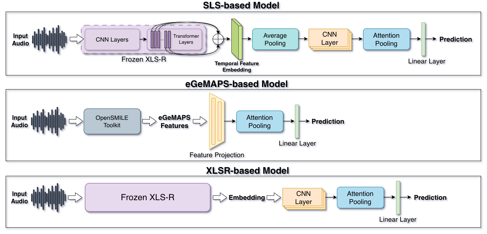
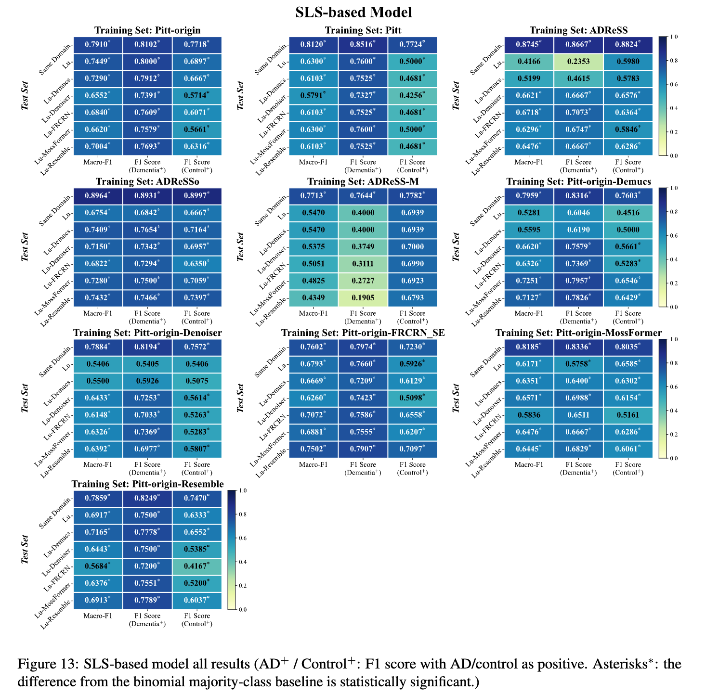
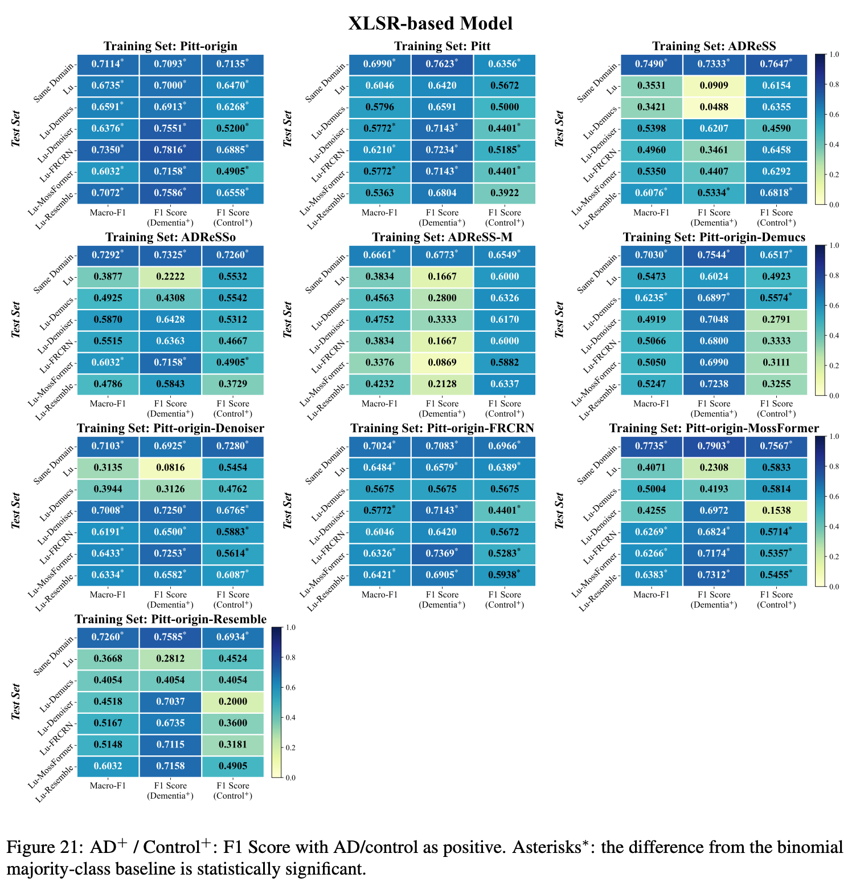
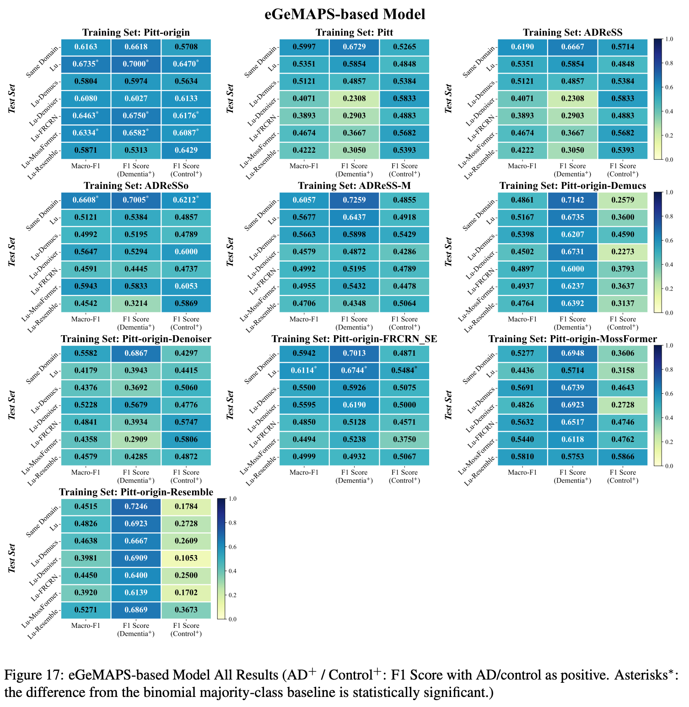
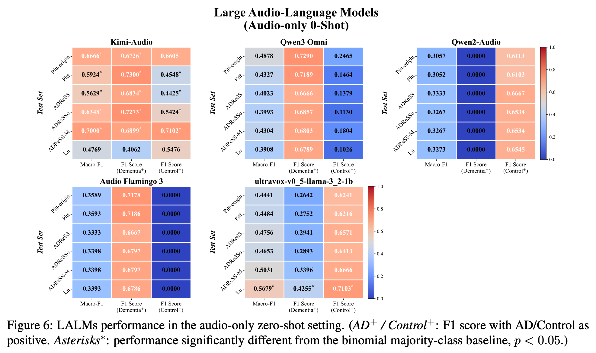
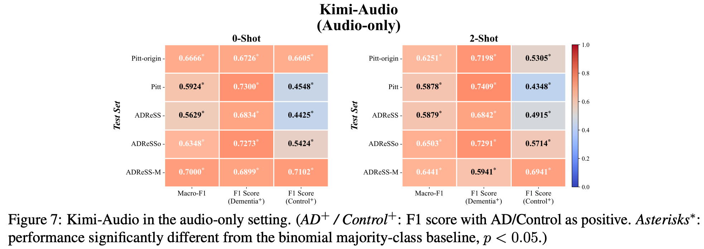
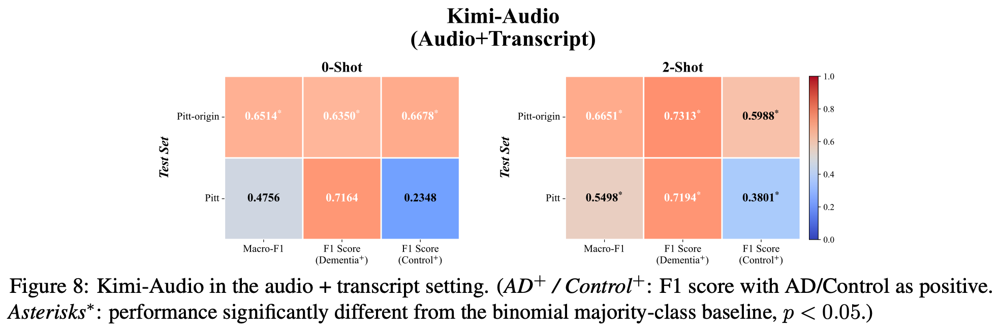

# Cleaner Speech, Weaker Generalization: Revisiting Pitt-Derived Benchmarks for Alzheimer’s Disease Detection

[](https://arxiv.org/abs/2609.00276)

Speech-based Alzheimer’s disease (AD) detection increasingly relies on speech-enhanced and curated versions of the Pitt Corpus, where speech enhancement, sample selection, and demographic balancing are often treated as beneficial preprocessing steps. However, whether these transformations improve real-world AD detection or instead affect model generalization and prediction behavior remains unclear. In this work, we revisit the role of speech preprocessing and dataset curation across widely used benchmarks for speech-based AD detection. We evaluate the speech quality of different datasets, the cross-dataset generalization of multiple deep learning models under matched and mismatched enhancement settings, and the behavior of several recent large audio-language models (LALMs). Experimental results show that across multiple supervised speech models, speech-enhanced datasets often improve in-domain performance while reducing robustness in cross-domain evaluation. Matched enhancement between training and test data alleviates, but does not eliminate, this degradation. LALMs show a similar sensitivity: enhanced datasets induce stronger class imbalance and prediction shifts than unprocessed data. These results suggest that speech preprocessing and dataset curation can substantially influence downstream AD detection behavior, indicating that “cleaner” speech datasets are not necessarily more reliable for real-world AD detection.

**Key finding:** Speech enhancement and sample filtering help in-domain metrics but hurt cross-domain generalization and shift LLM decision boundaries. Unprocessed Pitt-origin is the better training set for real-world AD speech detection.

## 1 Datasets

| Name        | Processing                                        | Source                          |
|-------------|---------------------------------------------------|---------------------------------|
| Pitt-origin | Raw data                                          | [DementiaBank — Pitt-origin](https://talkbank.org/dementia/access/English/Pitt-orig.html) |
| Pitt        | Derived from Pitt-origin (denoised)               | [DementiaBank — Pitt](https://talkbank.org/dementia/access/English/Pitt.html)             |
| ADReSS      | Derived from Pitt-origin (filtered + enhanced)    | [DementiaBank — ADReSS (2020)](https://talkbank.org/dementia/ADReSS-2020/)            |
| ADReSSo     | Derived from Pitt-origin (filtered + enhanced)    | [DementiaBank — ADReSSo (2021)](https://talkbank.org/dementia/ADReSSo-2021/index.html) |
| ADReSS-M    | Derived from Pitt-origin (filtered, not enhanced) | [DementiaBank — ADReSS-M (2023)](https://luzs.gitlab.io/madress-2023/) |
| Lu          | Raw data (distinct from Pitt-origin)              | [DementiaBank — Lu](https://talkbank.org/dementia/access/English/Lu.html)             |

All datasets from [DementiaBank](https://dementia.talkbank.org/). All the datasets use the "Cookie Theft" picture description task.

| Dataset     | Total | AD  | Control |
|-------------|:-----:|:---:|:-------:|
| Pitt-origin |  552  | 309 |   243   |
| Pitt        |  551  | 309 |   242   |
| ADReSS      |  156  |  78 |    78   |
| ADReSSo     |  237  | 122 |   115   |
| ADReSS-M    |  237  | 122 |   115   |

*Sample numbers of datasets.*

| Dataset     | Min(s) | Max(s) | Mean(s) | Median(s) | Total(min) |
|-------------|:------:|:------:|:-------:|:---------:|:----------:|
| Pitt Corpus | 18.00  | 268.48 |  70.06  |   63.29   |   643.39   |
| Pitt-origin | 17.89  | 268.49 |  69.97  |   63.20   |   643.72   |
| ADReSS      | 26.06  | 268.49 |  75.30  |   70.05   |   195.78   |
| ADReSSo     | 22.35  | 268.49 |  76.89  |   70.47   |   303.72   |
| ADReSS-M    | 22.35  | 268.49 |  76.89  |   70.48   |   303.72   |

*Audio duration statistics per dataset.*

## 2 Alzheimer's Dementia Recognition through Spontaneous Speech Challenges

The ADReSS / ADReSSo / ADReSS-M datasets were each released as part of a corresponding challenge:

- [ADReSS Challenge](https://luzs.gitlab.io/adress/) — Interspeech 2020.
- [ADReSSo Challenge](https://luzs.gitlab.io/adresso-2021/) — Interspeech 2021.
- [ADReSS-M Challenge](https://luzs.gitlab.io/madress-2023/) — ICASSP 2023.

## 3 Speech Enhancement Methods

We applied the following five speech enhancement methods to Pitt-origin and Lu, respectively. For each dataset, we constructed five denoised versions.

- [Denoiser](https://github.com/facebookresearch/denoiser) — Facebook Research.
- [MossFormer](https://github.com/modelscope/ClearerVoice-Studio) — ClearerVoice Studio.
- [FRCRN_SE](https://github.com/modelscope/ClearerVoice-Studio) — ClearerVoice Studio.
- [Resemble](https://github.com/resemble-ai/resemble-enhance) — Resemble AI.
- [Demucs](https://github.com/facebookresearch/demucs) — Facebook Research.


## 4 Model Architectures and Results



### **4.1 SLS-based Model**

The model uses `Sensitive Layer Selection (SLS)` on cached multi-layer `XLS-R` representations. Given frame-level representations from all transformer layers, the model first applies mask-aware mean pooling over time for each layer and predicts layer-wise weights through a linear layer followed by a sigmoid function. The original frame-level features are then aggregated across layers using the learned weights to obtain a weighted speech representation. This representation is passed through an classification head, including batch normalization, temporal average pooling, a one-dimensional convolutional layer, and attention pooling. Finally, a linear classification layer outputs the binary prediction.



### **4.2 XLSR-based Model**

The audio input is first fed into a pre-trained `XLS-R` model with frozen parameters to extract frame-level speech embeddings. The extracted features are then passed through a classification head similar to that of the SLS-based model, including batch normalization, a one-dimensional convolutional layer, and attention pooling, but without temporal average pooling. During attention pooling, a padding mask is applied to prevent padded frames from interfering with the results. Finally, a linear classification layer outputs the binary prediction.



### **4.3 eGeMAPS-based Model**

The model takes 25-dimensional `eGeMAPS` acoustic features extracted using the `OpenSMILE toolkit` as input. The features are first processed by two linear layers with batch normalization, ReLU activation, and dropout to remap the feature dimensions from 25 to 64 and then to 32. An attention pooling layer is then applied along the temporal dimension to aggregate frame-level representations into a fixed-dimensional vector. Finally, a linear classification layer outputs the AD prediction.



## 5 Large Audio-Language Models

We evaluate five recent large audio-language models (LALMs): [Kimi-Audio](https://github.com/MoonshotAI/Kimi-Audio), [Qwen3-Omni](https://github.com/QwenLM/Qwen3-Omni), [Qwen2-Audio](https://github.com/QwenLM/Qwen2-Audio), [Audio Flamingo 3](https://github.com/NVIDIA/audio-flamingo), and [ultravox-v0_5-llama-3_2-1b](https://huggingface.co/fixie-ai/ultravox-v0_5-llama-3_2-1b). No model is fine-tuned. Each model is prompted to answer with exactly one word, `Dementia` or `Control`. We report Macro-F1 together with the F1 score using AD (Dementia⁺) or Control (Control⁺) as the positive class, so that class imbalance in the predictions is visible. Asterisks (\*) mark performance significantly different from the binomial majority-class baseline (p < 0.05).

### **5.1 Audio-only Zero-Shot Setting**

All five LALMs are first evaluated zero-shot with audio-only input. Most models cannot reliably separate AD from Control: Qwen2-Audio predicts nearly every sample as Control, while Audio Flamingo 3 predicts nearly every sample as AD. Kimi-Audio achieves the strongest overall performance and is statistically significant on every dataset except Lu, so we use it for the remaining experiments.



### **5.2 Kimi-Audio: Audio-only Setting**

Kimi-Audio is evaluated in a zero-shot and a two-shot setting. In the two-shot setting, one labeled AD example and one labeled Control example are given at inference time, with no parameter updates. On the unprocessed Pitt-origin and ADReSS-M datasets, predictions are relatively balanced between the two classes. On the speech-enhanced datasets (Pitt, ADReSS, ADReSSo), the model shows clear class imbalance, with Dementia⁺ F1 substantially higher than Control⁺ F1. Two labeled examples do not remove this bias.



### **5.3 Kimi-Audio: Audio + Transcript Setting**

To test whether text mitigates this preprocessing sensitivity, Kimi-Audio is also evaluated on Pitt-origin and Pitt with audio + transcript input. Predictions on Pitt-origin remain balanced. On the denoised Pitt dataset, the bias toward AD persists and becomes even stronger in the zero-shot setting. Adding transcripts or two-shot examples does not eliminate the prediction shift caused by enhancement.



## 6 Frozen pretrained backbone

XLS-R-53 (300M), used as a frozen feature extractor in the SLS-based and XLSR-based models. 

Download `xlsr2_300m.pt` From: <https://huggingface.co/facebook/wav2vec2-xls-r-300m> and place it under `ad_detection/models/`.

XLS-R requires `fairseq` (only in the `deep` env). After installing `deep-requirements.txt`, install `fairseq` in the `deep` env:

```bash
pip install -e ad_detection/train/fairseq-a54021305d6b3c4c5959ac9395135f63202db8f1
```

## 7 Layout

- `ad_detection/`
  - `train/` — three deep-learning models (`SLS_Model/`, `XLSR_model/`, `eGeMAPS_model/`), each with `config.py` / `extract_feature.py` / `model.py` / `train.py` / `test.py`; shared helpers in `utils/`.
  - `train_notebook/`
    - `SLS/` — training and testing notebooks for the SLS-based model.
    - `XLSR/` — training and testing notebooks for the XLSR-based model.
    - `eGeMAPS/` — training and testing notebooks for the eGeMAPS-based model.
    - `LLM/` — Zero-shot / two-shot audio-only evaluation of Kimi-Audio, Qwen2-Audio, Qwen3-Omni, Audio Flamingo 3, Ultravox.  Audio-only and audio+transcript evaluation for Kimi-Audio
  - `data/` — dataset layout (raw / denoised / processed / transcripts). See `ad_detection/data/README.md`.
  - `models/` — checkpoints. See `ad_detection/models/Readme.md`.
- `requirements/` — `model_env/deep-requirements.txt` for the three deep models; `LLMs_env/` has a separate env per LLM.

## 8 Requirements

Create one conda env per requirements file. All three deep learning-base models use the same `deep` environment. Each LLM uses its own env to avoid dependency conflicts.

- `requirements/model_env/deep-requirements.txt` — env `deep`, used by all three deep-learning models (SLS, XLSR, eGeMAPS).
- `requirements/LLMs_env/kimi-requirements.txt` — env for Kimi-Audio.
- `requirements/LLMs_env/qwen-requirements.txt` — env for Qwen2-Audio and Qwen3-Omni.
- `requirements/LLMs_env/audio-flamingo3-requirements.txt` — env for Audio Flamingo 3.
- `requirements/LLMs_env/ultravox-requirements.txt` — env for Ultravox.

## 9 Acknowledgements

This project builds on the following open-source repositories. We thank the authors for releasing their code and models.

1. Deep learning-based Models:
   1. OpenSMILE: https://github.com/audeering/opensmile
   2. SLS (Sensitive Layer Selection): https://github.com/QiShanZhang/SLSforASVspoof-2021-DF
2. Speech Enhancement Methods:
   1. Denoiser: https://github.com/facebookresearch/denoiser
   2. ClearerVoice-Studio (MossFormer, FRCRN_SE): https://github.com/modelscope/ClearerVoice-Studio
   3. Resemble: https://github.com/resemble-ai/resemble-enhance
   4. Demucs: https://github.com/facebookresearch/demucs
3. Large audio-language models:
   1. Kimi-Audio: https://github.com/MoonshotAI/Kimi-Audio
   2. Qwen2-Audio: https://github.com/QwenLM/Qwen2-Audio
   3. Qwen3-Omni: https://github.com/QwenLM/Qwen3-Omni
   4. Audio Flamingo 3: https://github.com/NVIDIA/audio-flamingo
   5.  Ultravox: https://github.com/fixie-ai/ultravox